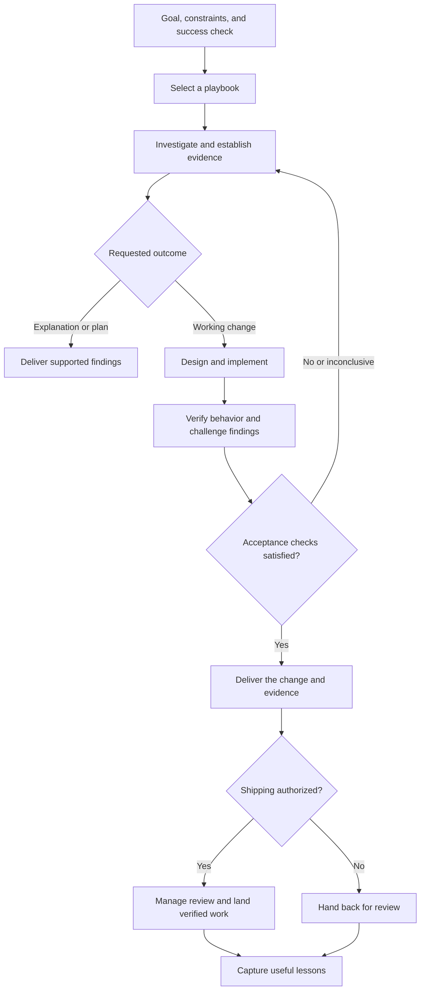

# Compose UI Testing with Robolectric Best Practices Skill

A workflow skill that makes an AI agent work like a disciplined team for **Jetpack Compose UI tests** that run on the JVM with **Robolectric**. You give it a goal, constraints, and a way to recognize success. It selects a playbook, investigates your project, makes a small change grounded in current official documentation, checks the real result, and brings back evidence you can review.

## How It Works

`SKILL.md` coordinates this flow:



The playbooks supply the task-specific steps:

| Playbook | Use for |
| --- | --- |
| `write-a-compose-ui-test.md` | Writing a new Compose UI test that runs on Robolectric |
| `debug-a-failing-test.md` | A test that fails for an unknown reason |
| `fix-a-flaky-test.md` | A test that passes and fails without code changes |
| `review-compose-ui-tests.md` | Reviewing existing tests against the documentation |
| `configure-robolectric.md` | Setting up Robolectric, the JDK, or CI |
| `migrate-to-v2-testing-apis.md` | Migrating tests to the v2 testing APIs |

Each playbook step cites a file in `references/`, a library whose sentences and code are taken word for word from current official documentation.

Example request:

> Goal: add a test that the checkout button is disabled until the form is valid. Constraints: no production code changes. Success: the new test passes, and fails when the validation is removed.

## Sources of Truth

The skill uses only current official Compose UI testing and Robolectric documentation. [`sources.txt`](sources.txt) defines that boundary:

- **Compose UI testing**: the Testing section of the Compose docs on developer.android.com, the `androidx.compose.ui.test` API reference, and the Compose UI release notes for the current stable and newer releases.
- **Robolectric**: robolectric.org guides and javadoc, the latest Robolectric release notes, and Android's Robolectric page. Blog posts are excluded, because they are dated or describe themselves as unofficial.

Every technical statement in the playbooks and reference files has an entry in [`verification/`](verification) that quotes the official page supporting it. A script checks that each quote appears word for word in the current text of that page, and that every sentence and code line in `references/` does too. Workflow instructions, such as "record the command and its result", are marked as workflow and may not name an API.

## Installation

```bash
npx skills add https://github.com/just-joshn/compose-ui-testing-robolectric-best-practices-skill
```

## Reference Files

**20 reference documents** in `references/`, organized into 6 categories, hold the documented facts the playbooks cite. Every sentence and code line in them appears word for word on the official page it is quoted from:

### Core (`references/core/`)

| Topic | Reference | Use for |
| --- | --- | --- |
| Test structure | `test-suite-structure.md` | Test anatomy, rules, v2 APIs, running on Robolectric |
| Configuration | `configuration.md` | Dependencies, `@Config`, `robolectric.properties`, JDK, system properties |
| Semantics & finders | `semantics-finders.md` | Finders, matchers, merged vs unmerged trees, test tags |
| Assertions & actions | `assertions-actions.md` | Assertions, actions, touch, key, and text input, scrolling |
| Synchronization | `synchronization.md` | Auto-sync, idling resources, `waitUntil`, main thread |
| Runtime modes | `runtime-modes.md` | Robolectric looper, graphics, and SQLite modes |

### Debugging (`references/debugging/`)

| Topic | Reference | Use for |
| --- | --- | --- |
| Debugging | `debugging.md` | Printing the semantics tree, failure artifacts, Robolectric logging |
| Flaky tests | `flaky-tests.md` | Synchronization, coroutine, looper, and thread causes |

### Testing Patterns (`references/testing-patterns/`)

| Topic | Reference | Use for |
| --- | --- | --- |
| Component testing | `component-testing.md` | Testing composables in isolation, custom semantics |
| Accessibility | `accessibility.md` | Accessibility checks, focus navigation tests |
| Animations | `animations.md` | Driving animations with the test clock |
| State restoration | `state-restoration.md` | `StateRestorationTester`, activity recreation |
| Visual regression | `visual-regression.md` | Native graphics and capturing a node |
| Coroutines | `coroutines.md` | v1 and v2 dispatchers, `runComposeUiTest`, coroutine contexts |

### Advanced (`references/advanced/`)

| Topic | Reference | Use for |
| --- | --- | --- |
| Clock control | `clock-control.md` | `MainTestClock`, `autoAdvance`, frame stepping |
| Device configuration | `device-configuration.md` | `DeviceConfigurationOverride`, Robolectric qualifiers |
| Interoperability | `interoperability.md` | Views, Espresso, UiAutomator with Compose |

### Architecture (`references/architecture/`)

| Topic | Reference | Use for |
| --- | --- | --- |
| Test architecture | `test-architecture.md` | Robolectric or device tests, source sets |
| Test doubles | `test-doubles.md` | Shadows, mocking and spying on Android classes |

### Infrastructure (`references/infrastructure-ci-cd/`)

| Topic | Reference | Use for |
| --- | --- | --- |
| CI/CD | `ci-cd.md` | Java versions, android-all downloads, mirrors and proxies |

## Not Covered

These topics are in the Playwright skill, but the official Compose UI testing and Robolectric docs don't cover them, so this skill leaves them out:

- Page objects, test tags, test data factories
- Authentication and multi-user flows
- Network mocking, GraphQL, WebSockets
- File upload and download
- Security testing and performance budgets
- CI provider recipes (GitHub Actions, GitLab, Docker), sharding, coverage, and reporting

Topics documented only outside that boundary are also left out: Hilt, Navigation, ViewModel and `kotlinx-coroutines-test` guidance, the Compose BOM, and Android Studio's screenshot testing tool.

## Validation

```bash
python3 scripts/check_skill.py      # flow chart sections, playbook stages, links, anchors, official-only URLs
python3 scripts/fetch_sources.py    # download the current text of every cited page into .cache/
python3 scripts/verify_claims.py    # every unit has quotes found word for word on those pages
```

`verify_claims.py` also checks that every API name in the code examples appears on an official page or is declared in the same example, and that advice (should, avoid, prefer, ...) is quoted from a page that gives that advice. It can't judge whether a quote fully supports its unit. That part was reviewed by hand.

## License

MIT
