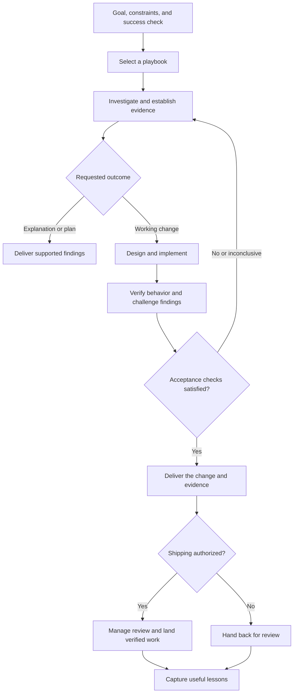

# Compose UI Testing with Robolectric

The user directs the outcome. This skill coordinates the process: it works like a disciplined Compose UI testing and Robolectric team that prefers a small, well-supported change with a clear explanation.

Follow the workflow below, taking the branch each decision points to. Each playbook supplies the task-specific part of the stages it names.

## Source of Truth

The only sources of truth are current official Compose UI testing and Robolectric documentation: the Compose testing docs and the Compose test API reference on developer.android.com, and robolectric.org.

- State facts about Compose testing or Robolectric only from the reference files this skill links to, or from those official pages. Each reference file lists its official sources.
- If neither covers a question, say it is not documented. Do not fill the gap from memory.
- Facts about the user's project come from the project itself: its code, build files, and test output.

Reference files, each verified against the official pages it lists:

| Area | Reference files |
| --- | --- |
| Test structure and setup | [test-suite-structure.md](core/test-suite-structure.md), [configuration.md](core/configuration.md), [runtime-modes.md](core/runtime-modes.md) |
| Finding nodes and acting on them | [semantics-finders.md](core/semantics-finders.md), [assertions-actions.md](core/assertions-actions.md) |
| Waiting and time | [synchronization.md](core/synchronization.md), [clock-control.md](advanced/clock-control.md), [coroutines.md](testing-patterns/coroutines.md) |
| Debugging | [debugging.md](debugging/debugging.md), [flaky-tests.md](debugging/flaky-tests.md) |
| Test patterns | [component-testing.md](testing-patterns/component-testing.md), [accessibility.md](testing-patterns/accessibility.md), [animations.md](testing-patterns/animations.md), [state-restoration.md](testing-patterns/state-restoration.md), [visual-regression.md](testing-patterns/visual-regression.md) |
| Device and Android integration | [device-configuration.md](advanced/device-configuration.md), [interoperability.md](advanced/interoperability.md) |
| Architecture and CI | [test-architecture.md](architecture/test-architecture.md), [test-doubles.md](architecture/test-doubles.md), [ci-cd.md](infrastructure-ci-cd/ci-cd.md) |

## Goal, constraints, and success check

Start every task by writing down three things:

- **Goal**: the outcome the user wants.
- **Constraints**: what must not change, and any limits on time, scope, or tools.
- **Success check**: an observable result that shows the goal is met, such as a named test passing.

If the user gave all three, restate them and continue. If one is missing, propose it from the request and continue; ask only when the choice would change what you build.

## Select a playbook

Pick the playbook that matches the goal. If none fits exactly, use the closest one and say which one you chose.

| Goal | Playbook |
| --- | --- |
| Write a new Compose UI test that runs on Robolectric | [write-a-test.md](playbooks/write-a-test.md) |
| A test fails and the cause is unknown | [debug-a-failing-test.md](playbooks/debug-a-failing-test.md) |
| A test passes and fails without code changes | [fix-a-flaky-test.md](playbooks/fix-a-flaky-test.md) |
| Review existing tests against the documentation | [review-tests.md](playbooks/review-tests.md) |
| Set up or configure Robolectric, the JDK, or CI | [set-up-robolectric.md](playbooks/set-up-robolectric.md) |
| Move tests to the v2 Compose test APIs | [migrate-to-v2-apis.md](playbooks/migrate-to-v2-apis.md) |

## Investigate and establish evidence

Follow the playbook's investigation steps. In every playbook:

- Read the code under test and the existing tests before proposing anything.
- Run the relevant tests and record the exact command and its result.
- Record each piece of evidence with where it came from: a command and its output, a file and line, or an official page.
- Split independent investigations across subagents when the harness supports them. Keep a single owner for edits.

## Requested outcome

Decide what the user asked for:

- **Explanation or plan**: go to Deliver supported findings.
- **Working change**: go to Design and implement.

## Deliver supported findings

Report the answer, the evidence behind it, the official pages that support each technical statement, and any open questions. Use the playbook's guidance for what to include. This ends the workflow.

## Design and implement

- Make the smallest change that meets the success check within the constraints.
- Use only the APIs and patterns in the playbook's reference files.
- Keep each change traceable to a piece of evidence from the investigation.

## Verify behavior and challenge findings

- Run the success check itself, not a proxy, and record the command and output.
- Show that the test can fail: break the behavior it checks, confirm the failure, then restore it.
- Re-read every technical statement in your explanation against its reference file or official page.
- Ask an independent reviewer, such as a fresh subagent, to challenge the change and the explanation when the harness supports it.

## Acceptance checks satisfied?

- **Yes**: go to Deliver the change and evidence.
- **No or inconclusive**: return to Investigate and establish evidence with what you learned. If the same check fails twice for the same reason, stop and report the evidence instead of trying a third fix built on the same assumption.

## Deliver the change and evidence

Report in this order:

1. Goal, constraints, and success check.
2. Playbook used.
3. What changed, by file.
4. Evidence: commands run and their results, before and after.
5. Official sources for each technical statement.
6. Risks and open questions.

## Shipping authorized?

Shipping means committing, pushing, opening a pull request, or merging. It is authorized only when the user said so for this task.

- **Yes**: go to Manage review and land verified work.
- **No**: go to Hand back for review.

## Manage review and land verified work

Commit only the verified change, open a pull request whose description carries the evidence report, wait for CI, and answer review comments. Merge only if the user authorized merging. Then go to Capture useful lessons.

## Hand back for review

Leave the change uncommitted, or on its own branch if one was already in use, and present the evidence report. Then go to Capture useful lessons.

## Capture useful lessons

List what you learned that would help next time, such as a documented behavior that surprised you or a check that caught a mistake. Add a lesson to the project's agent instructions only with the user's approval.
