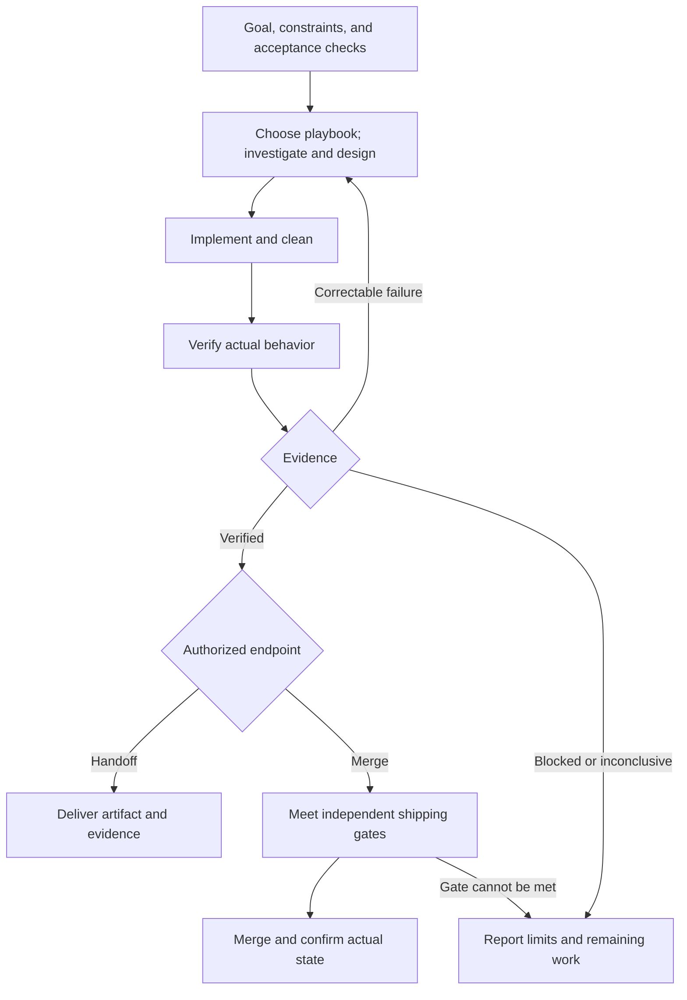

# Compose UI Testing with Robolectric

This skill is an opinionated, instruction-driven engineering workflow for Jetpack Compose UI tests that run on Robolectric. It tells you how to organize a task: establish the goal, select a suitable playbook, apply the engineering principles below, delegate according to that playbook, verify the outcome, and report the evidence.

The user supplies the desired result and constraints. You take responsibility for organizing the engineering work needed to reach that result.

Opinionated means the method is not left to your discretion. The skill encodes engineering judgments: the practices to prefer, the steps to require, and the approaches to reject. Follow them instead of weighing every alternative. When a user constraint conflicts with one of them, follow the user and say which judgment you set aside.

Follow the workflow below, taking the branch each decision points to. Each playbook supplies the task-specific part of the stages it names.

## Source of Truth

The only sources of truth are current official Compose UI testing and Robolectric documentation: the Compose testing docs and the Compose test API reference on developer.android.com, and robolectric.org.

- State facts about Compose testing or Robolectric only from the reference files this skill links to, or from those official pages. Each reference file lists its official sources.
- If neither covers a question, say it is not documented. Do not fill the gap from memory.
- Facts about the user's project come from the project itself: its code, build files, and test output. Comments in the project are evidence of what the project says, not documentation.

Reference files, each verified against the official pages it lists:

| Area | Reference files |
| --- | --- |
| Test structure and setup | [test-suite-structure.md](references/core/test-suite-structure.md), [configuration.md](references/core/configuration.md), [runtime-modes.md](references/core/runtime-modes.md) |
| Finding nodes and acting on them | [semantics-finders.md](references/core/semantics-finders.md), [assertions-actions.md](references/core/assertions-actions.md) |
| Waiting and time | [synchronization.md](references/core/synchronization.md), [clock-control.md](references/advanced/clock-control.md), [coroutines.md](references/testing-patterns/coroutines.md) |
| Debugging | [debugging.md](references/debugging/debugging.md), [flaky-tests.md](references/debugging/flaky-tests.md) |
| Test patterns | [component-testing.md](references/testing-patterns/component-testing.md), [accessibility.md](references/testing-patterns/accessibility.md), [animations.md](references/testing-patterns/animations.md), [state-restoration.md](references/testing-patterns/state-restoration.md), [visual-regression.md](references/testing-patterns/visual-regression.md) |
| Device and Android integration | [device-configuration.md](references/advanced/device-configuration.md), [interoperability.md](references/advanced/interoperability.md) |
| Architecture and CI | [test-architecture.md](references/architecture/test-architecture.md), [test-doubles.md](references/architecture/test-doubles.md), [ci-cd.md](references/infrastructure-ci-cd/ci-cd.md) |

## Engineering Principles

Apply every principle at every stage. Each one is required.

1. **Official documentation only.** State facts about Compose testing or Robolectric only from the reference files or the official pages. Reject answers from memory. If the documentation does not cover something, say so.
2. **Smallest sufficient change.** Make the smallest change that meets the success check. Reject refactors, extra tests, and cleanup the goal does not need.
3. **Evidence before conclusions.** Tie every finding to evidence from the project or a reference section. Reject conclusions supported only by reasoning.
4. **Verify the real result.** Run the success check itself. Reject a passing build, a code read, or a similar test as a substitute.
5. **Tests must be able to fail.** Show that every added or changed test fails when the behavior it checks is broken.
6. **Unresolved is not a pass.** Report a check without direct evidence as Unresolved, with the proof it is missing.
7. **Fix the cause.** Trace a failure to where it first goes wrong before changing code. Reject a change that makes a failure disappear without an evidence-backed explanation.
8. **Test the premise after two failures.** When two fixes built on the same assumption fail, test the assumption instead of trying a third fix.
9. **One owner for edits.** Only one agent edits files at a time. Delegated investigation is read-only.

## Preferred and Rejected Practices

These defaults come from the official documentation. Each links to the reference section that quotes it.

### Prefer

Choose each of these over its alternative whenever the choice arises.

- The v2 test APIs. The v1 APIs are deprecated, and migrating to the new APIs is strongly recommended. See [test-suite-structure.md](references/core/test-suite-structure.md#v2-apis).
- `runComposeUiTest` when Compose test APIs are used alongside the Kotlin `runTest` API, which the documentation strongly recommends. See [coroutines.md](references/testing-patterns/coroutines.md).
- A general concept such as `waitUntil()` for any condition that depends on external work, such as data loading or Android's measure or draw. See [synchronization.md](references/core/synchronization.md#waiting-for-conditions).
- The `PAUSED` looper mode, which is the default and which Robolectric strongly encourages. See [runtime-modes.md](references/core/runtime-modes.md#looper-mode).

### Require

Do each of these whenever its case arises.

- A device test for the cases Robolectric does not cover, such as system UI like edge-to-edge or picture-in-picture. See [test-architecture.md](references/architecture/test-architecture.md#device-tests).

### Reject

Do not introduce any of these, and do not leave one in code you change.

- An external `CountDownLatch` instead of the `waitUntil` APIs. In some cases it could behave unexpectedly, since the test clock won't be advanced. See [synchronization.md](references/core/synchronization.md#warnings).
- Using `ComposeTestRule`, for example `createComposeRule`, inside `runAndroidComposeUiTest` or its variants. See [test-suite-structure.md](references/core/test-suite-structure.md#cautions).
- Mocking or spying on Android classes that other Android code acts on, such as `Context` and `SharedPreferences`. See [test-doubles.md](references/architecture/test-doubles.md#mocking-and-spying-on-android-classes).
- Custom semantics properties that expose visual properties such as colors, font size, or rounded corner radius, which is not recommended. See [semantics-finders.md](references/core/semantics-finders.md#anti-patterns-to-avoid).
- The `LEGACY` looper mode. It is deprecated and not supported on Android SDKs above Baklava. See [runtime-modes.md](references/core/runtime-modes.md#deprecations).
- `enableAccessibilityChecks` on Robolectric: "This requires API 34+ (Android U), and currently does not work on Robolectric." See [accessibility.md](references/testing-patterns/accessibility.md#accessibility-checks).

## Delegation

Delegate as the selected playbook's Delegate section directs, and follow these rules:

- Delegate only the work the playbook names. Keep the work it leaves with you.
- Give each subagent the goal, the constraints, the success check, its playbook stage, and the files it may read.
- Every subagent, the reviewer included, is read-only. You remain the single owner of edits.
- The independent reviewer is a fresh agent that did not write the change.
- You own every delegated result. Check its evidence before you use it.
- If the harness has no subagents, do the delegated work yourself in the same order and say in the report that the review was not independent.

## Goal, constraints, and acceptance checks

Write down three things before anything else:

- **Goal**: the result the user wants.
- **Constraints**: what must not change, and any limits on time, scope, or tools.
- **Acceptance checks**: observable results that show the goal is met, such as a named test passing, or, for a review, every finding citing its evidence and source.

If the user gave all three, restate them and continue. If one is missing, propose it from the request, state that you assumed it, and continue. Do not stop to ask. A check you cannot make observable ends as Unresolved.

Then go to Choose playbook; investigate and design.

## Choose playbook; investigate and design

### Choose

Pick the playbook that matches the goal. If none fits exactly, use the closest one and say which one you chose.

| Goal | Playbook |
| --- | --- |
| Write a new Compose UI test that runs on Robolectric | [write-a-compose-ui-test.md](playbooks/write-a-compose-ui-test.md) |
| A test fails and the cause is unknown | [debug-a-failing-test.md](playbooks/debug-a-failing-test.md) |
| A test passes and fails without code changes | [fix-a-flaky-test.md](playbooks/fix-a-flaky-test.md) |
| Review existing tests against the documentation | [review-compose-ui-tests.md](playbooks/review-compose-ui-tests.md) |
| Set up or configure Robolectric, the JDK, or CI | [configure-robolectric.md](playbooks/configure-robolectric.md) |
| Migrate tests to the v2 testing APIs | [migrate-to-v2-testing-apis.md](playbooks/migrate-to-v2-testing-apis.md) |

### Investigate

- Follow the playbook's investigation steps, and delegate as its Delegate section directs.
- Read the code under test and the existing tests before proposing anything.
- Run the narrowest test command that covers the goal, confirm it targets the project's actual test task, and record the exact command and its result.
- Record each piece of evidence with where it came from: a command and its output, a file and line, or an official page.

### Design

- Design the smallest change that meets every acceptance check within the constraints.
- Use only the APIs and patterns in the playbook's reference files.
- Tie each part of the design to a piece of evidence from the investigation.
- When you return here after a correctable failure, start from that failure's evidence. Choose a different playbook if the evidence shows the task is a different kind. If two fixes built on the same assumption have failed, test that assumption before designing again.

When the design is complete, go to Implement and clean.

## Implement and clean

- Implement the design and nothing more. When the goal's result is a report, the report is the artifact.
- Clean before verifying: remove temporary code, debug output, and files added while investigating, and leave no change outside the design.

Then go to Verify actual behavior.

## Verify actual behavior

- Run each acceptance check itself, not a proxy, and record the command and output.
- For each test the change adds or modifies, show that it can fail: break the behavior it checks, confirm the failure, then restore it and clean again.
- Re-read every technical statement in your report against its reference file or official page. Drop any you cannot tie to one, or report it as not documented.
- Check the change against Preferred and Rejected Practices. Record a rejected practice in code you changed, or a required practice the change omits, as a Fail.
- Have a fresh reviewer challenge the artifact and the report. Re-grade any check whose result the reviewer shows its evidence does not support.
- Give each acceptance check exactly one result:
  - **Pass**: direct evidence shows the check is met, such as the command output.
  - **Fail**: direct evidence shows the check is not met.
  - **Unresolved**: you ran the check, or tried to, and there is still no direct evidence either way. Record the proof that is missing.
- Never count an unresolved check as a pass, and never describe it as likely to pass.

Then go to Evidence.

## Evidence

Decide from the results. Test Blocked or inconclusive first, then Correctable failure, then Verified. Exactly one applies.

- **Blocked or inconclusive**: any check is Unresolved; or a check is Fail and no step within the constraints that you have not yet tried could fix or explain it; or the same check is still Fail after two returns to Choose playbook; investigate and design. Go to Report limits and remaining work.
- **Correctable failure**: a check is Fail, no check is Unresolved, and a step within the constraints that you have not yet tried could fix or explain it. Return to Choose playbook; investigate and design.
- **Verified**: every acceptance check is Pass. Go to Authorized endpoint.

## Authorized endpoint

The user decides the endpoint. Merge is authorized only when the user explicitly told you in this task to merge. A request to commit, push, or open a pull request, a passing verification, and a reviewer's approval do not authorize it. In every other case the endpoint is Handoff.

- **Handoff**: go to Deliver artifact and evidence.
- **Merge**: go to Meet independent shipping gates.

## Deliver artifact and evidence

Do not merge. Leave the change uncommitted, or on its own branch if one was already in use, unless the user asked for a commit or pull request, and report in this order:

1. Goal, constraints, and acceptance checks.
2. Playbook used.
3. The artifact: what changed, by file, or the findings.
4. Evidence: each acceptance check with its result and the commands and output behind it, before and after.
5. The reference section behind each technical statement.
6. Risks and open questions.

Use the playbook's Deliver artifact and evidence section for what this task's report must contain.

## Meet independent shipping gates

A shipping gate is a check that does not rest on your own judgment. Meet every one:

- Commit only the verified change, and open a pull request whose description carries the evidence report.
- The pull request's CI passes.
- A fresh reviewer that did not write the change approves it. If none is available, this gate cannot be met.
- Every review comment is answered.

Do not change the verified change in this section. A gate that fails and needs such a change cannot be met.

When every gate is met, go to Merge and confirm actual state. If a gate cannot be met, go to Report limits and remaining work.

## Merge and confirm actual state

Merge, then confirm the target branch contains the change and its checks pass there. Report the state you found and the evidence for it. If the target branch lacks the change or a check fails there, say so and do not describe the merge as confirmed.

## Report limits and remaining work

Report in this order:

1. Goal, constraints, and acceptance checks.
2. What was done, with its evidence.
3. Each Fail or Unresolved check with its evidence and the proof that is missing, or the gate that cannot be met and why.
4. The remaining work needed to reach the goal.

Do not describe the result as verified or done.
